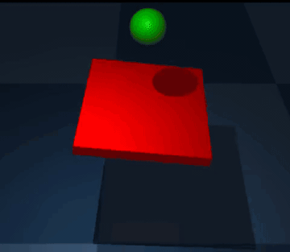
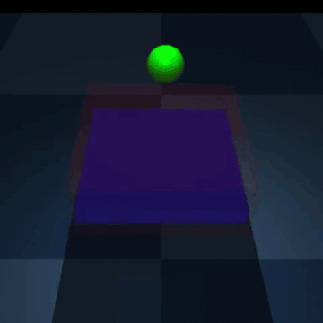
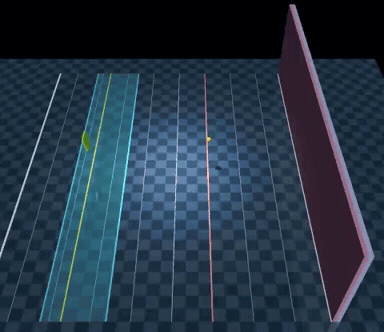

# Courtside Dynamics

[](https://github.com/kuds/courtside-dynamics/actions/workflows/ci.yml)

Courtside Dynamics is a progression of MuJoCo environments and deep
reinforcement-learning tools aimed at one long-term goal: **teach humanoid
agents to rally and play tennis**.

The project moves from simple ball control to racket-and-wall tasks and an
experimental two-humanoid tennis curriculum. Full learned humanoid tennis has
not yet been demonstrated.

## Installation

Courtside Dynamics supports Python 3.11 through 3.13.

```bash
git clone https://github.com/kuds/courtside-dynamics.git
cd courtside-dynamics
pip install -e ".[train]"
```

### Optional dependencies

- Base installation provides MuJoCo, Gymnasium, NumPy, ImageIO, and Packaging.
- `train` adds SB3, PyTorch, TensorBoard, pandas, Matplotlib, and MoviePy.
- `notebooks` adds MediaPy but intentionally does not install Jupyter. Colab
  provides and pins its own Jupyter server; install Jupyter or JupyterLab
  separately for a fresh local environment.
- `dev` adds pytest, pytest-timeout, pytest-xdist, Ruff, and mypy.

For training and notebooks together, run
`pip install -e ".[train,notebooks]"`.

## Quick start

Create a registered Gymnasium environment:

```python
import gymnasium as gym
import courtside_dynamics  # Registers the environments.

env = gym.make("CourtsideDynamics/BallBounce")
observation, info = env.reset(seed=0)
observation, reward, terminated, truncated, info = env.step(
    env.action_space.sample()
)
env.close()
```

Train from a curated Stable-Baselines3 (SB3) recipe:

```python
from courtside_dynamics.recipes import build_train_config
from courtside_dynamics.training import train

config = build_train_config(
    "WallBall",
    algo="SAC",
    log_dir="./logs/WallBall",
    quick_test=True,
    seed=0,
)
model = train(config)
```

`quick_test=True` runs a short pipeline check. Remove it to use the recipe's
full training budget. `seed=0` seeds SB3, workers, and helper environments;
exact results can still vary across hardware and runtime stacks.

## Environments

| Environment ID | Task | Status |
|---|---|---|
| `CourtsideDynamics/BallBalance` | Keep a ball on a 6-DoF tray. | Available |
| `CourtsideDynamics/BallBounce` | Deliberately rebound a ball from a 6-DoF paddle's top face. | Available |
| `CourtsideDynamics/WallBall` | Rally against a wall with a face-only paddle at a fixed 10° upward pitch, three target-controlled DoFs, and gated rewards. | Available |
| `CourtsideDynamics/PaddleTennis` | Rally 1v1 across a regulation net on the probe-frozen 13 m paddle court, against a scripted (or injected) opponent through an exact side mirror. | Available |
| `CourtsideDynamics/HumanoidTennisCoop` | Control two simulated Unitree G1 humanoids through one policy. | Available (experimental; free-standing default) |

Environment IDs are unversioned — use the IDs in the table above.
Releases routinely change physics, observations, actions, or recipes in
ways that determine which saved policies, `VecNormalize` statistics, and
learning curves stay comparable across versions; see
[`CHANGELOG.md`](CHANGELOG.md) for the per-version details and migration
notes, and [`docs/DECISIONS.md`](docs/DECISIONS.md) for why the
non-obvious choices were made.

| Ball Balance | Ball Bounce | Wall Ball |
|:---:|:---:|:---:|
|  |  |  |

`HumanoidTennisCoop` exposes a centralized single-agent Gymnasium interface:
one policy controls both players. It is compatible with the shared SB3
pipeline and is not a PettingZoo multi-agent environment.

## Training

### Recipes

Recipes hold each task's constructor settings, its default algorithm, a
calibrated settings block per algorithm family (see Algorithms below),
training budget, evaluation metric, recording schema, and artifact
schedule. The available recipe keys are:

- `BallBalance`
- `BallBounce`
- `WallBall`
- `WallBallVolley`
- `WallBallBaseline`
- `WallBallBootstrap` (historical — its reward package was falsified;
  see the recipe description)
- `WallBallDepthCurriculum` (historical — the sliding-fence ladder was
  retired by the 0.24.0 campaign diagnosis)
- `WallBallDepthCurriculumAligned` (historical — the aligned arm closed
  on the 2026-07-28 Phase D no-go)
- `WallBallGoalRally` (0.24.0 — direct goal-task training at the
  workspace baseline; the campaign-goal recipe)
- `WallBallTrueBaseline` (0.25.0 — the current era task on the extended
  ITF-baseline workspace)
- `PaddleTennis` (unreleased — the first two-sided rung: 1v1 cooperative
  rally on the probe-frozen paddle court vs the frozen scripted opponent,
  in continuous n-point play with the escrowed contact and reach
  shapings; selection and success follow the policy's own k≥2 rally
  returns, `episode_rally_returns_a`, on paired, seeded evaluation of
  the bare task, the shapings off: protocol `paddle-npoint@v3`)
- `HumanoidTennisStage0Intercept`
- `HumanoidTennisStage1AnchoredReturn`
- `HumanoidTennisStage2RandomizedReturn`
- `HumanoidTennisCoopSmoke`

The three fixed-stage humanoid recipes are experimental PPO starting points,
not evidence of learned convergence. SAC remains selectable, but its entropy
tuner sees all 58 action dimensions and is not mask-aware; PPO also spends
exploration on inactive coordinates. `HumanoidTennisCoopSmoke` is a 10,000-step
integration and recording check, not a learning baseline.

### Algorithms

`algo` selects `"SAC"`, `"DemoSAC"` (SAC with optional demonstration
injection, identical to SAC with it off) or `"PPO"`. SAC and DemoSAC
form the SAC family; PPO is the on-policy family. Each recipe keeps one
calibrated block per family, and `build_train_config(recipe, algo=...)`
applies the block for the run's family, so an SAC bundle never reaches
a PPO run. Every recipe carries a PPO profile (rollout geometry,
`target_kl`, exploration noise and reward normalization; see the PPO
design's section 3); the two historical depth ladders refuse PPO, since
their gates use SAC-only levers. The trainer runs PPO by on-policy
rules:

- Evaluation and checkpoint cadences must be whole rollouts of
  `n_steps × n_envs`, and the minibatch must divide the rollout.
  `train()` refuses anything else before writing a file.
- Early stops wait for `min_policy_updates_before_stop` (20) policy
  updates, and curriculum gates and schedules change the task only
  between rollouts.
- An MLP-policy run trains on the CPU unless it sets a device, and a
  reward-normalizing run discounts its return statistics with the
  model's own gamma.

Every loader (`best_model.zip` replay, the campaign scorer, the
PaddleTennis tools) loads a checkpoint through the algorithm its run's
`config.json` records (`training.algos.load_run_model`). `config.json`
records the algorithm, its family and implementation (`sb3==<version>`),
and a comparability key (task, evaluation protocol, algorithm family)
that keeps SAC and PPO runs of one task apart. A PPO run's
`stage_summary.txt` also flags trust-region and exploration trouble
under Training Health. Two learning bars guard PPO: a CI test learns a
1-D reach through `train()` in about 11 s, and
`tools/ppo_learning_probe.py` (minutes; run by hand, a nightly job is
planned) must balance BallBalance for at least 700 of 750 steps on 20
held-out seeds. See [`docs/design_ppo_first_class_20261016.md`](docs/design_ppo_first_class_20261016.md).

For full control, construct `TrainConfig` directly:

```python
from courtside_dynamics.envs import BallBounceEnv
from courtside_dynamics.training import TrainConfig, train

config = TrainConfig(
    env_fn=lambda: BallBounceEnv(render_mode="rgb_array", min_force=100.0),
    algo="SAC",
    total_timesteps=1_500_000,
    log_dir="./logs/BallBounce",
    name_prefix="ball_bounce",
)
model = train(config)
```

### Run configuration files

Run hyperparameters can be kept in a per-experiment TOML file passed as
`build_train_config(..., config_file=...)`: its `[train.model_kwargs]`
table deep-merges onto a recipe's calibrated bundle instead of replacing it,
every unknown key fails loudly with a suggestion, and each run copies the
file to `LOG_DIR/run_config.toml` and records its path, sha256, and content
in `config.json`. See [`docs/run_config_file_spec.md`](docs/run_config_file_spec.md)
for the format and precedence rules. A starter TOML per recipe ships inside
the package (`courtside_dynamics/run_configs/`, see its README): discover them
with `run_config.available_run_configs()` and copy one for editing with
`run_config.copy_starter_config(env_name, dest_dir)` — so Colab's
pip-installed sessions can bootstrap a config without cloning the repo.

### Notebooks

- [`notebooks/sb3_training.ipynb`](notebooks/sb3_training.ipynb) is the generic
  Colab driver for every recipe.
- [`notebooks/humanoid_tennis_training.ipynb`](notebooks/humanoid_tennis_training.ipynb)
  runs the gated Stage 0–2 PPO transfer curriculum.
- [`notebooks/rescore_runs.ipynb`](notebooks/rescore_runs.ipynb) re-scores a
  Drive runs folder's best models and checkpoints under an evaluation
  protocol on CPU (by default the August PaddleTennis runs under
  `paddle-npoint@v3`), into a scores folder beside `training_runs/`, with
  per-checkpoint curves and a `select()` verdict per run.

The humanoid notebook advances after a passing canonical evaluation. It
warm-starts the next stage from the passing policy and its matching observation
normalizer, while starting with a fresh optimizer and reward-normalization
state. Reward, episode length, rally count, and return counts remain diagnostics
unless the notebook user enables them as additional criteria.

## Humanoid tennis status

The implemented system includes a regulation court, physical tennis ball and
net, two simulated 29-DoF Unitree G1 humanoids, rigid right-wrist rackets,
ordered MuJoCo contact events, and a deterministic rally state machine.

Serve/feed sides alternate unless explicitly overridden. The default
free-standing mode uses bounded seeded launch noise near the baseline; Stages
0–1 use deterministic mirrored anchored feeds, and Stage 2 randomizes that
anchored launch. Reset and step `info` retain the serve side and full initial
ball `qpos`/`qvel` for recording.

### Curriculum stages

| Stage | Task | Controls and availability |
|---|---|---|
| 0 | Fixed-pelvis intercept of a slow physical feed | Returning player's shoulder pitch/roll; environment and recipe available |
| 1 | Anchored right-arm return into a generous target | Returning player's seven right-arm controls; environment and recipe available |
| 2 | Anchored target return with bounded launch randomization | Same right-arm controls; environment and recipe available |
| 3–5 | Standing, mobile-partner, and two-learned-player milestones | Planned; selecting them raises `NotImplementedError` |
| 6 | Two free-standing players | Environment mode available; no validated training recipe |

For Stages 0–2, the learned returner is the non-serving side and alternates as
feed sides alternate. Physical weld constraints hold both pelvises, inactive
joints receive standing-reference PD targets, and early contact forgiveness
changes only the massless stringbed dimensions. Curriculum settings remain
fixed for an environment instance; reset-time stage mixing would be partially
observed and is intentionally unsupported.

### API contract

The centralized API keeps the same 58 actions and 299 observations across all
available modes. A zero action is the two-player standing-reference PD hold.

| Action slice | Controls |
|---|---|
| `[0:29]` | Player A |
| `[29:58]` | Player B |
| `[22:29]` | Player A right arm and racket |
| `[51:58]` | Player B right arm and racket |

The action mask is all ones in free-standing mode and selects only the learned
controls in constrained stages. Stage 0 activates `[22:24]` for player A or
`[51:53]` for player B; Stages 1–2 activate the corresponding seven-value
right-arm slice.

| Observation slice | Contents |
|---|---|
| `[0:71]` | Player A proprioception |
| `[71:142]` | Player B proprioception |
| `[142:157]` | Physical racket A |
| `[157:172]` | Physical racket B |
| `[172:181]` | Ball position, velocity, and spin |
| `[181:193]` | Ball-relative coordinates |
| `[193:221]` | Rally state |
| `[221:231]` | Contact-latch state |
| `[231:241]` | Contact-release progress |
| `[241:299]` | Active-action mask |

Humanoid recipes normalize continuous physical observations at indices
`0–192` and leave the bounded rally, contact, and action-mask tail at
`193–298` raw. This prevents newly active curriculum flags from inheriting
near-zero variance when a normalizer transfers between stages.

### Rules, rewards, and validation

The rule reducer confirms a legal return only after the ball crosses the net
and is then volleyed or lands in bounds. It suppresses duplicate contact
episodes and reports explicit fault reasons for double bounces, out balls,
illegal hits, net contacts, and unsafe simulation.

With the default reward configuration, an ordinary fault pays `-1` and unsafe
or non-finite physics pays `-2`. In non-curriculum mode, a confirmed legal
return pays `+1`; survival, feed crossings, first bounces, and unconfirmed
racket taps pay zero. The canonical curriculum presets instead award `+1` for
Stage 0's first valid learned-player racket hit or Stages 1–2's valid target
return. Optional hit shaping is escrowed and clawed back when the return fails.

The scripted full-tennis, Stage 0, and Stage 1 oracles validate physical
feasibility and mirrored rule behavior. They are test fixtures, not evidence of
learned policies; the Stage 1 oracle is deliberately timing-sensitive.

## Humanoid curriculum evaluation and promotion

`evaluate_curriculum_stage` evaluates a fixed-stage environment and records
the policy, checkpoint, normalizer, package source, Git revision, suite, and
runtime identities. `assess_curriculum_promotion` then applies an advisory
gate:

- 50 seeded launches mirrored across both court orientations, producing 100
  episodes and 100 unique physical initial states;
- at least 80% success overall and on each serving-side orientation for the
  current stage, and at least 75% overall and per side on every implemented
  predecessor;
- zero unsafe episodes by default;
- canonical preset, recipe horizon, rule/contact settings, and held-out suite;
- fresh evidence from the same policy and normalizer for every earlier stage.

Normalized policies must provide the exact frozen `VecNormalize` artifact used
with the checkpoint. Easier custom variants remain useful experiments but are
not promotion-eligible. The evaluator rolls out and closes fresh environment
instances; neither helper changes curriculum configuration, checkpoints,
recipes, training runs, or promotion state. The dedicated curriculum notebook
consumes the report to advance automatically. Replay-buffer migration and mixed
prior-stage rehearsal are not implemented.

## Training artifacts and diagnostics

Completed runs and runs orderly salvaged after `KeyboardInterrupt` capture the
configuration and diagnostic evidence needed to investigate training. Some
artifacts appear only when their corresponding callback fires or feature is
enabled.

| Path | Contents |
|---|---|
| `config.json` | Resolved training settings, environment class/space/curriculum metadata, resolved SB3 settings, versions, device, Git SHA, and warm-start identities |
| `run_config.toml` | Byte-exact copy of the TOML run config, when one was used |
| `stage_summary.txt` | Final evaluation and, when scheduled evaluation ran, best evaluation, plus duration, throughput, device, and final training-health metrics |
| `run_record.json` | What ran and how it ended (`courtside-run-record/1`): status (`running`, then `completed`, `early_stop`, `interrupted` or `crashed`) and stop reason, budget, algorithm, task fingerprints, comparability key, seeds, git state, warm start, selection, evaluation snapshots, and wall clock with its evaluation share. Written when `train()` starts and rewritten on every terminal path |
| `sync_manifest.json` | Path, size and sha256 of every other file, written last. A run directory without one that verifies is incomplete: `python -m courtside_dynamics.experiments.verify <run_dir>`. With `TrainConfig.sync_dir` (the notebooks' `LOCAL_THEN_SYNC`), a run trains on local disk and mirrors itself there at every checkpoint and at the end, each mirror sealed by its own manifest |
| `model/` | The protected best pair (`best_model.zip`, `best_vec_normalize.pkl`) with `best_model_meta.json` binding them by sha256, each written to a temporary file and renamed into place; the end-of-run `final_model.zip` and `vec_normalize.pkl`; and `stage_bests/`, one archived best per curriculum stage |
| `metrics/` | `eval_info.csv` (matched-stage info metrics), `eval_info_final.csv` (the unsynced goal-task stream), `evaluations.npz`, `progress.csv`, and the `tensorboard/` and `monitor/` directories |
| `checkpoints/`, `media/videos/` | Periodic snapshots and milestone rollout recordings |
| `snapshots/` | With `TrainConfig.snapshot_evals` (on in the PaddleTennis recipe): the policy and normalizer at every evaluation, bound by sha256 in `snapshots/index.json`, for offline re-scoring |
| `scores/` | Written after training by `python -m courtside_dynamics.experiments.rescore --protocol <id> <run_dir>`: one row per scored model under an evaluation protocol |
| `reports/` | `curriculum_stages.json` (per-stage entry/exit, promotion windows, per-stage bests), `ladder_certification.json` (the startup scripted sweep of the gate's stages, 0.23.0+), the held-out long-horizon audit (`best_model_long_horizon_eval.json` and its per-episode CSV), and the diagnostic plots |

`courtside_dynamics.notebook_utils` can replay the stage summary, audit a run
directory, explain missing optional artifacts, and plot learning, evaluation,
and training-health CSVs. The notebooks run these diagnostics after training.

`python -m courtside_dynamics.experiments.index --root <training_runs>`
regenerates `<root>/index/runs.jsonl`, one row per run directory: run records
as written with their manifest verdict, and older directories backfilled from
`config.json` and `stage_summary.txt` (aborted launches marked as stubs), each
joined to the campaign map of what it tested. See
[`docs/experiments.md`](docs/experiments.md), which also covers verification
and Colab use.

`python -m courtside_dynamics.experiments.rescore --protocol paddle-npoint@v3
<run_dir>` re-scores a run's best model, evaluation snapshots and checkpoints
offline under a versioned evaluation protocol, with the in-loop evaluator's
own code (under the run's own protocol, a snapshot's row equals its
`eval_info.csv` row bit for bit on CPU: every evaluation of a paired run, the
first of an unpaired one; a performance-gated run has no such protocol);
`experiments.select.select()` picks a best from the rows, and
`python -m courtside_dynamics.experiments.probe` scores the scripted
witnesses or any model under a protocol. `paddle-npoint@v3`, the PaddleTennis
recipe's selection protocol since 2026-10-17, evaluates without the
training shapings, so evaluation rewards are task reward; its k≥2 headline
reads exactly what the earlier `paddle-npoint@v2` reads. Each run's
`config.json` names its in-loop protocol (id and fingerprint) in the
comparability key (a gated run says it has none). See
[`docs/experiments.md`](docs/experiments.md) for the
protocols, re-scoring a Drive folder with `notebooks/rescore_runs.ipynb`,
and the probe CLI.

## Development

Install the development and training dependencies, then run the checks:

```bash
pip install -e ".[train,dev]"
ruff check .
mypy
pytest
```

`pytest` runs the suite serially in about 3.5 minutes. To parallelize,
**always pin the thread pools**:

```bash
OMP_NUM_THREADS=1 MKL_NUM_THREADS=1 pytest -n 2
```

Measured on 4 cores: 209s serial → 88–133s across runs. The pinning is
not optional —
the same `-n 2` with torch's default thread count exceeded 600s, a >3×
regression, because each `pytest-xdist` worker oversubscribes threads.
That is why `-n` is deliberately absent from `addopts`; CI pairs the two
explicitly.

To check that a built distribution actually works — as opposed to merely
building — install it and run the packaging smoke test:

```bash
python -m build --wheel
pip install dist/*.whl        # in a fresh venv, not the source checkout
python tools/smoke_wheel.py
```

This is the only check that can catch a missing
`[tool.setuptools.package-data]` glob: the simulation assets (MJCFs, STL
meshes, starter TOMLs) sit beside the code in a source tree whether or not
they are packaged, so the test suite passes either way while wheel users
fail at environment construction. CI runs it on every build.

### Refactor gates

Env and training refactors must leave the task's streams and the SAC
training paths bit-identical unless the change is declared. Three gates
check it, and a mismatch means "declare it", never "re-record it":

1. **Env digests** (`tools/golden_digest.py`). Per-step digests of
   seeded scripted streams: 22 cases in the CI set, or five spaced
   seeds per case with `--full` (two for the humanoid case; the NaN
   witnesses keep the one seed each is calibrated on). CI runs the CI
   set through `tests/test_golden_digests.py`; run `--full` by hand.
2. **Recipe snapshot** (`tools/recipe_snapshot.py`). Every resolved
   `TrainConfig`. CI runs it through `tests/test_recipe_snapshot.py`.
3. **Trainer digest** (`tools/trainer_digest.py --base <ref>`). Tiny
   seeded `train()` jobs on this checkout and on a worktree of the ref.
   It runs by hand only; in CI, `tests/test_trainer_digest.py` covers
   its hashing, not the jobs.

Before a merge that touches the envs or training, run all three by
hand; CI covers only gate 1's CI set and gate 2:

```bash
OMP_NUM_THREADS=1 python tools/golden_digest.py           # gate 1, CI set (~45 s)
OMP_NUM_THREADS=1 python tools/golden_digest.py --full    # gate 1, full set (~3.5 min)
python tools/recipe_snapshot.py                            # gate 2
python tools/trainer_digest.py --base main                 # gate 3 (~2 min)
python -m mypy                                             # the typecheck, as CI runs it
```

Run mypy the way CI's typecheck job does: `python -m mypy`, in an
environment with the train extra installed (`pip install -e
".[train,dev]"`; CI uses Python 3.11). A mypy that cannot import
numpy, Gymnasium and SB3, such as a global or `uv tool` install, treats
them as `Any` under `ignore_missing_imports` and passes silently.

In a git worktree, run the gates with
`PYTHONPATH=src`: the editable install imports the main checkout's
package there, and the tools and the test suite refuse to run against
it. See
[`docs/DECISIONS.md`](docs/DECISIONS.md), "Golden digests and the freeze
harness gate every refactor".

The suite covers Gymnasium registration and API invariants, MuJoCo physics and
contact semantics, rally rules, fixed-stage curriculum and promotion metrics,
SB3 training and callbacks, run artifacts, and notebook helpers. Rendering is
also smoke-tested when a display or virtual framebuffer is available.

### Repository layout

```text
courtside-dynamics/
├── pyproject.toml
├── CHANGELOG.md                 # Per-release changes and migration notes
├── docs/                        # Specs, design docs, reviews, and the
│                                #   decisions/lessons journal (see docs/README.md)
├── src/courtside_dynamics/
│   ├── assets/                  # MJCF, court, racket, and robot assets
│   ├── envs/                    # Gymnasium tasks and curriculum contracts
│   ├── callbacks/               # Evaluation and video recording
│   ├── training/                # SAC/PPO training, artifacts, and promotion
│   ├── experiments/             # Run records, sync manifests, verification, run index,
│   │                            #   snapshots, eval protocols, re-scoring harness, select, probe
│   ├── run_configs/             # Packaged starter TOMLs, one per recipe
│   ├── digests.py               # Golden env-stream digests (the refactor gate)
│   ├── recipes.py               # Curated environment/training presets
│   ├── run_config.py            # TOML run-config loading, merge, provenance
│   ├── notebook_utils.py        # Colab setup, plots, replay, and audits
│   └── scripted_policies.py     # Deterministic validation oracles
├── tools/                       # Calibration sweeps, packaging checks, refactor gates
├── notebooks/
└── tests/                       # golden/: the recorded digests and snapshot
```

For the engineering rationale behind the current design — the bugs, dead ends,
and calibration decisions worth remembering — see
[`docs/DECISIONS.md`](docs/DECISIONS.md); [`docs/README.md`](docs/README.md)
indexes all supplementary documentation.

## Attribution and related work

The Unitree G1 simulation assets are pinned from MuJoCo Menagerie under
BSD-3-Clause; see [`THIRD_PARTY_NOTICES.md`](THIRD_PARTY_NOTICES.md). The
physical G1 hardware is proprietary, and its inclusion does not imply Unitree
endorsement.

- [LATENT](https://zzk273.github.io/LATENT/) provides research evidence for G1
  tennis and a possible future motion-prior path; it is not a dependency of
  this project.
- [Serving Up Some Robotics: Setting Up a Tennis Environment in MuJoCo](https://www.findingtheta.com/blog/serving-up-some-robotics-setting-up-a-tennis-environment-in-mujoco)
